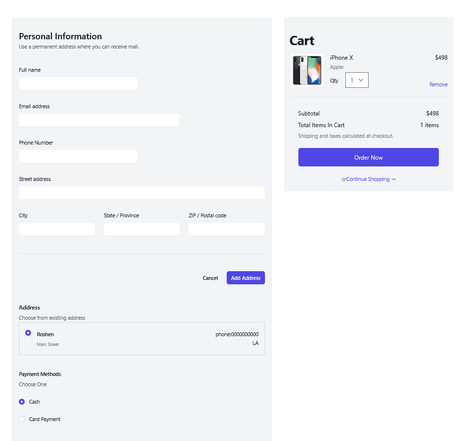

# ShopAura 🛍️

ShopAura is a full-stack e-commerce web application built with the MERN stack. It brings together a React storefront and an Express/Node.js REST API backed by MongoDB, with user authentication, product discovery, cart and order management, an admin area, and Stripe payment integration.

The project is organized into two main applications:

- **Frontend:** React, Redux Toolkit and Tailwind CSS
- **Backend:** Node.js, Express.js and MongoDB (Mongoose)

---

## Table of Contents

- [Overview](#overview)
- [Features](#features)
- [Screenshots](#screenshots)
- [Technology Stack](#technology-stack)
- [Project Structure](#project-structure)
- [Getting Started](#getting-started)
  - [Prerequisites](#prerequisites)
  - [Clone the Repository](#clone-the-repository)
  - [Backend Setup](#backend-setup)
  - [Frontend Setup](#frontend-setup)
- [Environment Configuration](#environment-configuration)
- [Application Workflow](#application-workflow)
- [API Overview](#api-overview)
- [Available Scripts](#available-scripts)
- [Security Notes](#security-notes)
- [Future Improvements](#future-improvements)
- [Contributing](#contributing)
- [License](#license)

---

## Overview

ShopAura provides an end-to-end shopping experience with separate customer and administrator functionality. Customers can browse products, filter and sort the catalogue, manage their cart, maintain account details and addresses, and place orders. Administrators can manage catalogue data and review and update orders.

The frontend uses Redux Toolkit to manage application state and communicate with the backend API. The backend exposes REST endpoints, persists application data in MongoDB, protects authenticated routes using JWT-based authentication stored in an HTTP-only cookie, and integrates with Stripe for card payments.

## Features

### Customer experience

- **Account management:** Sign up, log in, log out and restore the authenticated session when the application is refreshed.
- **Product catalogue:** Browse products with product details, images, pricing, ratings and stock information.
- **Product discovery:** Filter products by category and brand, sort results and navigate paginated product listings.
- **Shopping cart:** Add products to the cart, view cart items and update quantities or remove items.
- **Checkout:** Review an order, select a saved address and choose an available payment method.
- **Payments:** Card payment flow powered by Stripe, alongside the cash-on-delivery option represented in the checkout flow.
- **Order history:** View orders associated with the signed-in customer.
- **Profile management:** View and update account information and saved addresses.

### Administration

- **Product management:** Create, view and update product information.
- **Catalogue management:** Work with product categories and brands.
- **Order management:** View orders and update order information/status.
- **Administrative views:** Dedicated pages and protected frontend routes for administrative tasks.

### Technical highlights

- REST API built with Express.js.
- MongoDB persistence through Mongoose models.
- Password hashing with bcryptjs.
- JWT authentication using HTTP-only cookies.
- Protected API routes through authentication middleware.
- Centralized frontend state management with Redux Toolkit.
- Asynchronous API operations using Redux Toolkit's async patterns.
- Product filtering, sorting and pagination.
- Stripe PaymentIntent integration and a webhook endpoint for payment events.
- Responsive interface built with React and Tailwind CSS.

---

## Screenshots

> Replace the placeholder image URLs below with screenshots of your running application. You can also upload the images to a folder such as `docs/screenshots/` and reference them using relative paths.

### Customer storefront

| Product listing | Product details |
|---|---|
|  |  |

### Shopping and checkout

| Shopping cart | Checkout |
|---|---|
|  |  |

### Account and administration

| Admin dashboard |
|---|
|  |

| Order history | Product management |
|---|---|
|  |  |

---

## Technology Stack

### Frontend

| Technology | Purpose |
|---|---|
| React 18 | Component-based user interface |
| Redux Toolkit | Application state management |
| React Redux | Connecting React components to the Redux store |
| React Router DOM | Client-side routing |
| Tailwind CSS | Styling and responsive layouts |
| React Hook Form | Form handling and validation |
| Axios / Fetch API | HTTP communication |
| Stripe.js and React Stripe.js | Stripe payment UI |
| Headless UI and Heroicons | Accessible UI primitives and icons |

### Backend

| Technology | Purpose |
|---|---|
| Node.js | JavaScript runtime |
| Express.js | REST API and server |
| MongoDB | NoSQL database |
| Mongoose | MongoDB object modelling |
| JSON Web Token (JWT) | Authentication tokens |
| bcryptjs | Password hashing |
| cookie-parser | Reading authentication cookies |
| CORS | Cross-origin request configuration |
| dotenv | Environment variable configuration |
| Stripe | Payment processing |

---

## Project Structure

The repository contains separate frontend and backend applications.

```text
ShopAura/
├── backend/
│   ├── controller/       # Request handlers and business logic
│   ├── middleware/       # Authentication middleware
│   ├── model/            # Mongoose schemas and models
│   ├── routes/           # Express route definitions
│   ├── build/            # Production frontend build served by Express
│   ├── index.js          # Backend entry point
│   └── package.json
│
├── frontend/
│   ├── public/
│   ├── src/
│   │   ├── app/          # Redux store configuration
│   │   ├── features/     # Feature modules and Redux slices
│   │   ├── pages/        # Application pages
│   │   ├── App.js
│   │   └── index.js
│   └── package.json
│
└── README.md
```

### Backend modules

- `controller/`: Authentication, products, cart, orders, users, brands and categories.
- `model/`: MongoDB schemas for users, products, carts and orders.
- `routes/`: API route definitions grouped by resource.
- `middleware/`: JWT cookie validation and request authentication.
- `index.js`: Express configuration, database connection, API mounting, Stripe integration and static frontend hosting.

### Frontend modules

- `features/auth/`: Signup, login, logout and session state.
- `features/product-list/`: Product catalogue, filters and product state.
- `features/cart/`: Cart API operations and Redux state.
- `features/order/`: Order operations and Redux state.
- `features/user/`: User profile and account operations.
- `features/admin/`: Product and order administration components.
- `pages/`: Route-level pages such as product details, checkout, profile and order pages.

---

## Getting Started

Follow these steps to run ShopAura locally.

### Prerequisites

Install the following before starting:

- [Node.js and npm](https://nodejs.org/)
- [MongoDB](https://www.mongodb.com/) — a local MongoDB instance or MongoDB Atlas database
- [Stripe account](https://stripe.com/) — required to test card payments
- Git

### Clone the repository

```bash
git clone https://github.com/roshen1234/ShopAura.git
cd ShopAura
```

### Backend Setup

1. Open a terminal in the backend directory:

   ```bash
   cd backend
   ```

2. Install dependencies:

   ```bash
   npm install
   ```

3. Create a `.env` file inside the `backend/` directory and configure the variables described in [Environment Configuration](#environment-configuration).

4. Start the backend in development mode:

   ```bash
   npm run dev
   ```

   Or start it normally:

   ```bash
   npm start
   ```

The backend connects to MongoDB and listens on the port configured by the `PORT` environment variable.

### Frontend Setup

1. Open another terminal in the frontend directory:

   ```bash
   cd frontend
   ```

2. Install dependencies:

   ```bash
   npm install
   ```

3. Start the React development server:

   ```bash
   npm start
   ```

The Create React App development server normally opens at [http://localhost:3000](http://localhost:3000).

**API connection note:** The frontend code calls API paths such as `/products`, `/auth/login` and `/cart` as relative URLs. The repository's current setup serves the production frontend build from the Express backend. If you run the React development server separately, configure a development proxy or equivalent API routing so those requests reach the backend.

### Running the production frontend through Express

The backend is configured to serve the React production build from `backend/build`.

1. Build the frontend:

   ```bash
   cd frontend
   npm install
   npm run build
   ```

2. Copy the generated contents of `frontend/build/` into `backend/build/` (replace the existing build files).

3. Configure the backend environment variables and start the backend:

   ```bash
   cd ../backend
   npm install
   npm start
   ```

4. Open the backend URL in your browser, using the port configured in `PORT`.

This deployment arrangement allows the frontend and API to be served by the same Express application.

---

## Environment Configuration

Create `backend/.env` locally. Do not commit real credentials or secret keys.

The backend references the following environment variables:

| Variable | Description |
|---|---|
| `PORT` | Port on which the Express server listens |
| `MONGODB_URL` | MongoDB connection string |
| `STRIPE_SERVER_KEY` | Stripe secret key used by the backend |
| `END_POINT_SECRET` | Stripe webhook signing secret |

Example structure (use your own values):

```env
PORT=8080
MONGODB_URL=your_mongodb_connection_string
STRIPE_SERVER_KEY=your_stripe_secret_key
END_POINT_SECRET=your_stripe_webhook_signing_secret
```

The frontend Stripe integration also requires a Stripe **publishable key**. Use your own test-mode publishable key in the frontend configuration; never put a Stripe secret key in frontend code.

For local webhook testing, Stripe CLI can forward events to the backend webhook endpoint:

```bash
stripe listen --forward-to localhost:8080/webhook
```

Use the webhook signing secret printed by Stripe CLI as the local `END_POINT_SECRET` value. Restart the backend after changing environment variables.

---

## Application Workflow

A simplified view of how the main parts work together:

1. A customer interacts with the React frontend.
2. Frontend feature modules dispatch asynchronous operations and update Redux state with API responses.
3. Express routes receive the requests and invoke their corresponding controllers.
4. Controllers read and write application data through Mongoose models.
5. For authenticated endpoints, middleware reads the JWT from the HTTP-only cookie and validates the request.
6. During checkout, the backend creates a Stripe PaymentIntent and the frontend uses Stripe.js to complete the card payment.
7. Stripe can notify the backend about payment events through the `/webhook` endpoint.

---

## API Overview

The backend exposes the following route groups. Authenticated route groups require a valid login cookie unless otherwise noted.

| Base path | Method | Purpose |
|---|---|---|
| `/auth/signup` | POST | Register a customer |
| `/auth/login` | POST | Authenticate a customer |
| `/auth/check` | GET | Check the current authenticated session |
| `/products` | GET | Retrieve products, with filtering, sorting and pagination support |
| `/products` | POST | Create a product |
| `/products/:id` | GET | Retrieve a product |
| `/products/:id` | PATCH | Update a product |
| `/categories` | GET / POST | List or create categories |
| `/brands` | GET / POST | List or create brands |
| `/cart` | GET | Retrieve the current user's cart |
| `/cart` | POST | Add an item to the cart |
| `/cart/:id` | PATCH | Update a cart item |
| `/cart/:id` | DELETE | Remove a cart item |
| `/orders/own/` | GET | Retrieve the current user's orders |
| `/orders` | GET / POST | List orders or create an order |
| `/orders/:id` | PATCH / DELETE | Update or delete an order |
| `/users/own/` | GET | Retrieve the current user's profile |
| `/users/:id` | PATCH | Update a user |
| `/create-payment-intent` | POST | Create a Stripe PaymentIntent |
| `/webhook` | POST | Receive Stripe webhook events |

Product listing supports query parameters for category, brand, sorting and pagination. The product endpoint also returns an `X-Total-Count` response header for paginated results.

> This is a high-level route reference based on the current backend route definitions. Check the route and controller files for request-body formats and implementation details.

---

## Available Scripts

### Frontend (`frontend/`)

| Command | Description |
|---|---|
| `npm start` | Start the React development server |
| `npm run build` | Create an optimized production build |
| `npm test` | Run the React test runner |
| `npm run eject` | Eject Create React App configuration (one-way operation) |

### Backend (`backend/`)

| Command | Description |
|---|---|
| `npm start` | Start the Express server |
| `npm run dev` | Start the server with Nodemon |

---

## Security Notes

- Keep MongoDB credentials, Stripe secret keys and webhook signing secrets in environment variables.
- Do not commit `.env` files. If a real credential has ever been committed, revoke or rotate it and remove it from the repository's tracked files.
- The current authentication implementation contains a JWT signing secret directly in backend source code. Before deploying, move this secret into an environment variable, rotate it, and ensure it is never exposed to the frontend.
- Use HTTPS in production so authentication cookies and payment traffic are protected in transit.
- Review authorization checks on administrative endpoints before deploying. Authentication alone should not grant every signed-in user administrator privileges.
- Validate and sanitize incoming request data and enforce ownership checks for user-specific cart, order and profile operations.
- Use Stripe test credentials for local development and configure production credentials only in the deployment environment.

---

## Future Improvements

Potential areas for extending the project:

- Add automated backend unit and integration tests.
- Add role-based authorization checks for every administrative API operation.
- Improve request validation and centralized error handling.
- Add order-payment reconciliation and robust webhook event handling.
- Add product search and richer filtering.
- Add deployment automation and CI checks.
- Add API documentation with OpenAPI / Swagger.

---

## Contributing

Contributions and suggestions are welcome.

1. Fork the repository.
2. Create a feature branch: `git checkout -b feature/your-feature`.
3. Commit your changes: `git commit -m "Add your feature"`.
4. Push the branch: `git push origin feature/your-feature`.
5. Open a pull request describing your changes.

---

## License

No license is currently specified in this repository. Unless a license is added, the default copyright restrictions apply. Add a license file if you intend to permit reuse or redistribution.

---

**Repository:** [roshen1234/ShopAura](https://github.com/roshen1234/ShopAura)
